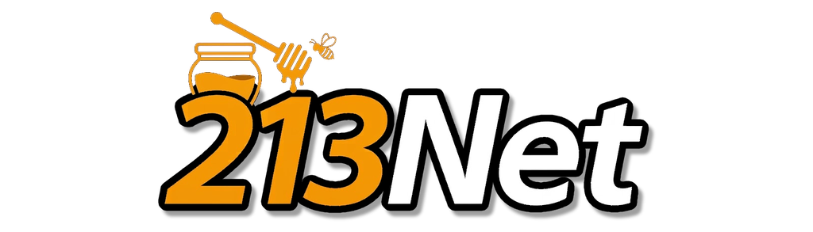

  

A custom client for [DDNet](https://ddnet.org), the Teeworlds-based
cooperative platformer, focused on visual customization and convenience.

> **Work in progress.** 213Net is an unofficial fork and is not affiliated
> with or endorsed by DDNet

## Planned features

- **Discord Rich Presence:** shows that you are playing 213Net
- **Warlist system:** built-in warlist managed with chat commands
- **Utility lists:** war list and team list
- **Censor list:** censor and replace unwanted words everywhere: chat, nameplates, scoreboard and more
- **Info search:** look up and display player or map data from DDStats
- **Player indicator:** track players around you without zooming out (not available on PvP servers)
- **Frozen tee display:** see all frozen players on your team
- **Profiles:** save and load player settings: skin, colors, emote, name, clan and flag
- **Visual enhancements:** rainbow skins, weapons and hook colors, tee trails, smooth animations
- **Fonts:** a wide selection of fonts, plus custom font support
- **Input and ping improvements:** reduced input lag and anti-lag ping tools
- **Quality-of-life tweaks** for HUD and chat

213Net adds no cheats and no unfair advantages.

## Building

See the [DDNet build instructions](https://github.com/ddnet/ddnet#building)
for requirements; 213Net builds the same way.

## Credits and license

213Net is an unofficial fork of [DDNet](https://github.com/ddnet/ddnet)
and contains code and ideas from other DDNet clients:

- [DDNet](https://github.com/ddnet/ddnet) and Teeworlds: the original game and base client
- [TClient](https://github.com/TaterClient/TClient) by Tater: (list the features taken from it)
- [Cactus Client](https://cactuss.top): (list the features taken from it)

All credit for the borrowed features goes to their authors.
Files taken from other projects keep their original license headers.
213Net is distributed under the zlib license, see [license.txt](license.txt).
